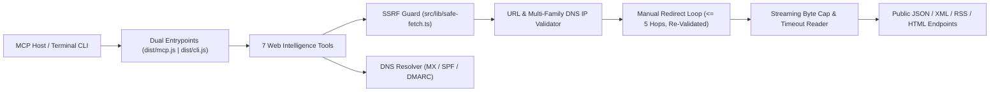

# open-web-intel-mcp

**Zero-Proxy, Zero-Browser Local TypeScript MCP Server & CLI for SSRF-Safe Web Intelligence.**

`open-web-intel-mcp` gives AI coding agents, desktop assistants, and developer pipelines fast, direct access to structured public web data—without headless browsers, paid proxy pools, or API keys. Every outbound HTTP request passes through a shared defense-in-depth SSRF guard with DNS resolution checks, manual redirect hop re-validation, strict timeouts, and streaming byte caps.

---

## Key Capabilities

- **Zero Headless Browser Overhead**: Queries clean public JSON, XML, RSS, DNS, and HTML endpoints directly on Node.js `>=20.18.1` (Node 20.18+ / 22).
- **Defense-in-Depth SSRF Protection**: Blocks private RFC1918 networks, loopback, CGNAT, cloud metadata (`169.254.169.254`), link-local, unique-local IPv6, NAT64/6to4/Teredo, and IPv4-mapped IPv6 addresses across every DNS record and `redirect: 'manual'` hop.
- **Token-Lean 7-Tool Schema**: Concise, read-only tool definitions (~1,460 tokens across all 7 tools combined) designed for minimal LLM context overhead and zero prompt-injection surface.
- **Dual Entrypoints**:
  - `open-web-intel-mcp`: Model Context Protocol server over `stdio` (default) or stateless Streamable HTTP (`--http --port 3000`).
  - `open-web-intel`: Standalone terminal CLI with human-readable and `--json` output modes.

---

## Architecture



---

## Installation & Quick Start

```bash
git clone https://github.com/pie527645-cloud/open-web-intel-mcp.git
cd open-web-intel-mcp
npm install
npm run build

# Optional: link `open-web-intel` and `open-web-intel-mcp` binaries globally
npm link
```

---

## MCP Client Configuration

Point your MCP client directly at the built `dist/mcp.js` entrypoint:

### Claude Desktop (`claude_desktop_config.json`)

```json
{
  "mcpServers": {
    "open-web-intel": {
      "command": "node",
      "args": ["/absolute/path/to/open-web-intel-mcp/dist/mcp.js"]
    }
  }
}
```

### Cursor (`.cursor/mcp.json`)

```json
{
  "mcpServers": {
    "open-web-intel": {
      "command": "node",
      "args": ["/absolute/path/to/open-web-intel-mcp/dist/mcp.js"]
    }
  }
}
```

### Antigravity (`mcp_config.json`)

```json
{
  "mcpServers": {
    "open-web-intel": {
      "command": "node",
      "args": ["/absolute/path/to/open-web-intel-mcp/dist/mcp.js"]
    }
  }
}
```

> **Note:** On Windows, pass a forward-slash or escaped path (for example `"C:/path/to/open-web-intel-mcp/dist/mcp.js"`). Once published to npm, you can also invoke a pinned release via `"command": "npx", "args": ["open-web-intel-mcp@1.0.0"]`.

### Stateless Streamable HTTP Mode

Start the server locally bound to `127.0.0.1` (default) with `Host` and `Origin` DNS-rebinding protection enabled:

```bash
node dist/mcp.js --http --port 3000
# Health check: GET  http://127.0.0.1:3000/health
# MCP endpoint: POST http://127.0.0.1:3000/mcp

# Optional custom Host / Origin allowlists for reverse-proxy or container setups:
node dist/mcp.js --http --host 0.0.0.0 --port 3000 --allowed-hosts mcp.internal:3000 --allowed-origins https://app.internal
```

---

## The 7 MCP Tools

| Tool Name | Purpose | Key Inputs |
| :--- | :--- | :--- |
| `fetch_markdown` | Fetches a public URL, strips scripts/styles/navigation boilerplate, converts to clean Markdown with `title` & `approxTokens`, and optionally probes `/llms.txt`. | `url`, `includeLlmsTxt`, `maxChars` |
| `crawl_sitemap` | Reads `robots.txt` and crawls XML sitemaps (`urlset` & `sitemapindex`) with bounded recursion and URL count limits. | `url`, `maxUrls`, `maxDepth`, `pathFilter` |
| `search_ats_jobs` | Queries direct public JSON/XML career APIs for `greenhouse`, `lever` (US & EU), `ashby`, `workable`, `personio`, and `recruitee`. | `provider`, `company`, `keywords`, `location`, `remoteOnly`, `leverRegion`, `maxJobs` |
| `search_remote_jobs` | Aggregates and deduplicates remote tech listings across `remotive`, `jobicy`, `himalayas`, `remoteok`, and `weworkremotely` with graceful partial-failure handling. | `keywords`, `sources`, `maxJobs` |
| `inspect_ecommerce_store` | Queries public Shopify (`/products.json`, `/meta.json`) and WooCommerce (`/wp-json/wc/store/v1/products`) catalogs plus storefront app/pixel signals. | `url`, `maxProducts` |
| `enrich_domain_intel` | Extracts public contact emails, social profile links, `/llms.txt` status, DNS `MX`/`SPF`/`DMARC` posture, and tech stack signatures. | `domainOrUrl`, `checkContactPage` |
| `search_podcasts_rss` | Queries the Apple Podcasts Search API (`itunes.apple.com/search`) or a direct RSS URL and parses show metadata, owner `<itunes:email>`, and recent episodes. | `query`, `maxShows`, `maxEpisodesPerShow`, `country` |

---

## CLI Usage (`open-web-intel`)

Every tool is available directly from the terminal via `open-web-intel` (or `node dist/cli.js`). Pass `--json` on any subcommand for structured JSON output.

```bash
# Show CLI help and all flags
open-web-intel --help

# 1. Fetch clean Markdown + probe /llms.txt
open-web-intel fetch https://modelcontextprotocol.io/introduction --llms-txt --max-chars 20000

# 2. Discover robots.txt and crawl XML sitemaps
open-web-intel sitemap https://modelcontextprotocol.io --max-urls 100 --filter /docs --json

# 3. Search public ATS job boards (greenhouse | lever | ashby | workable | personio | recruitee)
open-web-intel ats greenhouse stripe --keywords "typescript" --remote-only --max-jobs 15 --json
open-web-intel ats lever spotify --region auto --max-jobs 10

# 4. Aggregate & deduplicate remote jobs across 5 public feeds
open-web-intel remote --keywords "backend typescript" --sources remotive,himalayas,weworkremotely --max-jobs 20 --json

# 5. Inspect a Shopify or WooCommerce storefront
open-web-intel store https://allbirds.com --max-products 10 --json

# 6. Enrich a domain with emails, socials, DNS MX/SPF/DMARC, llms.txt & tech stack
open-web-intel enrich cloudflare.com --json

# 7. Search podcasts & parse RSS feeds for host/owner email and recent episodes
open-web-intel podcasts "software engineering" --max-shows 3 --max-episodes 2 --country US --json
```

---

## Security Design (`src/lib/safe-fetch.ts`)

1. **Scheme & Credential Enforcement**: Permits only `http:` and `https:` URLs without embedded `username:password` credentials.
2. **Hostname & Full Multi-Family DNS Validation**: Rejects `localhost`, `.localhost`, `.local`, `.internal`, `metadata.google.internal`, and IPv6 zone IDs (`%`). Resolves all `A` and `AAAA` records (`dns.lookup` with `{ all: true, verbatim: true }`) and blocks the request if **any** returned IP falls in:
   - Loopback (`127.0.0.0/8`, `::1`), unspecified (`0.0.0.0/8`, `::`)
   - RFC1918 private (`10.0.0.0/8`, `172.16.0.0/12`, `192.168.0.0/16`)
   - Carrier-Grade NAT (`100.64.0.0/10`)
   - Link-local & Cloud Metadata (`169.254.0.0/16`, `fe80::/10`)
   - Unique local IPv6 (`fc00::/7`), site-local (`fec0::/10`), multicast (`224.0.0.0/4`, `ff00::/8`)
   - IPv4-mapped/compatible/translated IPv6 (`::ffff:0:0/96`, `::/96`), NAT64 (`64:ff9b::/96`), 6to4 (`2002::/16`), and Teredo (`2001:0000::/32`)
3. **Socket-Level Connect Pinning (`undici.Agent`) & Manual Redirect Re-Validation**: Eliminates DNS-rebinding TOCTOU by validating all resolved IPs inside a custom `undici.Agent` `connect.lookup` callback and pinning the TCP/TLS socket directly to the validated public IP. Uses `redirect: 'manual'` exclusively (<= 5 hops), re-validating every `Location` target before connecting and stripping sensitive headers across origins.
4. **Resource & Parser Bounds**: Enforces per-hop `AbortSignal.timeout` deadlines, cancels response streams immediately when cumulative chunk bytes exceed `maxBytes`, caps HTML parser input at 512 KiB, and uses linear `O(n)` `indexOf` tag scanning immune to unclosed-tag ReDoS.
5. **Streamable HTTP Origin & Host Protection**: Validates `Host` and `Origin` headers on `/mcp` and `/health` before instantiating transports (configurable via `--allowed-hosts` / `ALLOWED_HOSTS` and `--allowed-origins` / `ALLOWED_ORIGINS`).

---

## Docker

```bash
docker build -t open-web-intel-mcp .
docker run --rm -p 127.0.0.1:3000:3000 open-web-intel-mcp --http --host 0.0.0.0 --port 3000
```

---

## Development & Testing

```bash
npm install
npm run lint    # Strict TypeScript check across src/ and tests/
npm run build   # Compile ESM output + declarations to dist/
npm test        # Run offline SSRF, tool fixture, CLI, and live stdio/HTTP MCP tests
```

---

## Need Managed Cloud Scale, Scheduling & Pay-Per-Event Apify Actors?

Running high-volume scheduled crawls, webhook pipelines, persistent datasets, or multi-company batch jobs without keeping your local machine online? Check out the companion cloud Actors and automation templates:

| Use Case | Managed Cloud Actor / Resource | Highlights |
| :--- | :--- | :--- |
| **Multi-Company ATS Career Feeds** | [ATS Career Jobs Scraper](https://apify.com/tsun_tsun/ats-career-jobs-scraper?fpr=cn0u9m) | Batch-scrape Greenhouse, Lever, Ashby, Workable & SmartRecruiters across dozens of companies on a schedule. |
| **Bulk Shopify Store Intelligence** | [Shopify Store Intel](https://apify.com/tsun_tsun/shopify-store-intel?fpr=cn0u9m) | Large-scale catalog, pricing, app, pixel, and storefront intelligence exported to JSON/CSV/Webhook. |
| **B2B Domain & Tech Stack Enrichment** | [Website Lead & Tech Enricher](https://apify.com/tsun_tsun/website-lead-tech-enricher?fpr=cn0u9m) | Enrich hundreds of domains with public contacts, DNS MX/SPF/DMARC posture, `llms.txt`, and 70+ tech signatures. |
| **Newsletter & Content Archives** | [Substack Intelligence Scraper](https://apify.com/tsun_tsun/substack-intelligence-scraper?fpr=cn0u9m) | Full newsletter archive extraction with clean Markdown conversion and outbound link graphs. |
| **Workflow & n8n Templates Hub** | [Apify Automation Toolkit](https://pie527645-cloud.github.io/apify-automation-toolkit/) | Ready-to-import automation blueprints, scheduling guides, and integration recipes. |

---

## License

[MIT](./LICENSE)
